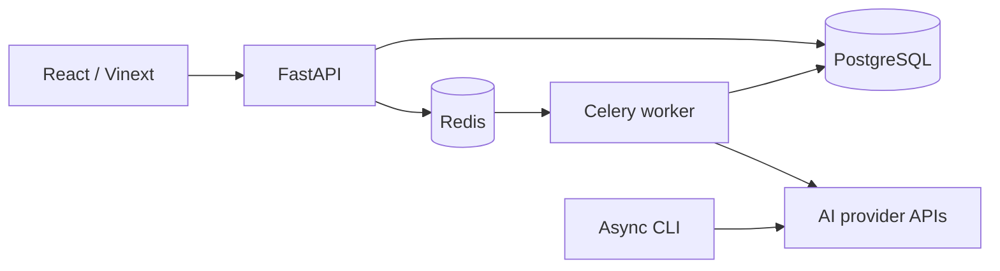

# Evalflow — LLM Evaluation Platform

[](https://github.com/foreg0n/llm-evaluation-platform/actions/workflows/ci.yml)

Compare language models on your own datasets and inspect answer quality,
latency, token usage, estimated cost, and errors in one workspace.

Evalflow combines a React analytics interface, a FastAPI backend, PostgreSQL
experiment storage, and concurrent model execution through LiteLLM. Bring your
own provider keys, import test cases, and compare models across runs.

[Quick start](#quick-start) · [User guide](docs/GUIDE.md) ·
[Five-minute demo](docs/DEMO.md) · [Deployment](DEPLOYMENT.md)

## What You Can Do

- Connect multiple AI providers with per-user API keys encrypted at rest.
- Discover available models or enter a model ID manually.
- Import JSON, JSONL, and NDJSON datasets with file-wide validation.
- Launch concurrent evaluations with retries, timeouts, progress, and cancellation.
- Compare exact match, normalized match, keywords, latency, tokens, and cost.
- Filter individual responses, compare completed runs, and export JSON or CSV.
- Keep experiments private through authenticated, user-owned projects.
- Explore logs, Prometheus metrics, Grafana dashboards, and optional tracing.

The provider catalog includes Groq, OpenAI, Anthropic, Gemini, OpenRouter,
Mistral, and other LiteLLM integrations. Custom OpenAI-compatible endpoints
support local and privately hosted models.

## Tech Stack

| Layer | Technologies |
| --- | --- |
| Frontend | React, TypeScript, Vinext, Vite, Tailwind CSS |
| API and storage | FastAPI, Pydantic, async SQLAlchemy, PostgreSQL, Alembic |
| Evaluation | LiteLLM, asyncio, deterministic text metrics |
| Background work | Celery and Redis |
| Observability | Prometheus, Grafana, Tempo, OpenTelemetry, optional Sentry |
| Delivery and checks | Docker Compose, GitHub Actions, pytest, Ruff, ESLint |

## Quick Start

Use Docker Desktop with Linux containers, or Docker Engine with Docker
Compose. Local Python and Node.js installations are not needed for this path.
You will need a provider API key when you run a real evaluation.

### 1. Clone the repository

```bash
git clone https://github.com/foreg0n/llm-evaluation-platform.git
cd llm-evaluation-platform
```

### 2. Configure a new installation

Copy the environment template.

Windows PowerShell:

```powershell
Copy-Item .env.example .env
```

macOS / Linux:

```bash
cp .env.example .env
```

Generate the three required values using Docker. This command works in
PowerShell and Bash:

```text
docker run --rm python:3.12-slim-bookworm python -c "
import base64, secrets
print('POSTGRES_PASSWORD=' + secrets.token_hex(24))
print('AUTH_SECRET_KEY=' + secrets.token_hex(32))
print('CREDENTIAL_ENCRYPTION_KEY=' + base64.urlsafe_b64encode(secrets.token_bytes(32)).decode())
"
```

Paste the resulting values into the matching entries in `.env`. Keep these
settings for the local HTTP stack:

```dotenv
REFRESH_COOKIE_SECURE=false
EMAIL_BACKEND=console
FRONTEND_PUBLIC_URL=http://localhost:3000
```

For an existing installation, keep your current `.env`, database password,
and encryption key. Changing the encryption key makes previously saved
provider credentials unreadable. Environment files are Git-ignored.

### 3. Start the application

```bash
docker compose up -d --build
docker compose ps -a
```

Open [Evalflow](http://localhost:3000). API documentation is available at
[localhost:8000/docs](http://localhost:8000/docs). The migration container
exiting with code `0` is expected.

Register an account. With console email delivery, find the verification link
in the API logs and open it before signing in:

```bash
docker compose logs --tail=100 api
```

There is no default admin login or password.

Stop the stack with `docker compose down`; named data volumes are preserved.
See the [user guide](docs/GUIDE.md) for local Python/Node development,
configuration, authentication, and troubleshooting.

## Run Your First Evaluation

1. In **AI Providers**, save your provider API key.
2. Create a project and open **Collections → Datasets → Import file**.
3. Upload [portfolio-benchmark.json](examples/portfolio-benchmark.json),
   which contains 15 test cases.
4. In **Models**, add one or two variants, attach a saved credential, and
   choose text-generation models from the available list.
5. In **Evaluation runs**, choose the dataset and models, set concurrency
   to `2`, and start the evaluation.
6. Inspect the leaderboard and responses, then export the run or compare it
   with another completed run.

Provider calls use your own API quota or credits. The benchmark includes no
credentials. Reference answers and keywords are used for scoring; they are
not sent to the models.

See the [demo guide](docs/DEMO.md) for a complete walkthrough and the
[user guide](docs/GUIDE.md#running-evaluations) for API and CLI usage.

## How It Works



The API persists each run and schedules background work. The worker evaluates
dataset-item/model pairs concurrently and saves results as they complete.
Provider failures are recorded per task. Development can also run evaluations
inside the API process without Celery.

Quality scores use exact match, normalized exact match, and keyword coverage.
They are useful for short reference-answer tests, but do not measure general
reasoning or semantic equivalence. Costs are estimates when the provider
integration supplies pricing information.

## Development and Checks

For a local setup, use Python 3.12+, Node.js 22.13+, and PostgreSQL. Follow the
[installation instructions](docs/GUIDE.md#installation) and
[contribution guide](CONTRIBUTING.md).

Backend checks, from the repository root after installing development
dependencies:

```bash
python -m ruff check backend evals tests scripts
python -m pytest
python scripts/release_audit.py
```

Frontend checks, from a separate terminal:

```bash
cd frontend
npm ci
npm run lint
npm run audit:production
npm test
```

Backend tests mock provider responses and use temporary SQLite databases.
GitHub Actions additionally validates migrations and Compose files, builds
containers, and runs an isolated PostgreSQL backup/restore drill.

## Documentation

| Document | Contents |
| --- | --- |
| [User and developer guide](docs/GUIDE.md) | Setup, providers, datasets, API, CLI, authentication, and operations |
| [Demo guide](docs/DEMO.md) | A five-minute project walkthrough |
| [Deployment and recovery](DEPLOYMENT.md) | Production setup, releases, backups, and recovery |
| [Contributing](CONTRIBUTING.md) | Development workflow and required checks |
| [Release checklist](RELEASE_CHECKLIST.md) | Release validation |
| [Changelog](CHANGELOG.md) | Version history |
| [Security](SECURITY.md) | Security policy and reporting |

## Development Approach

Evalflow is a personal learning and portfolio project developed with AI
assistance across the backend, evaluation core, and frontend. The author
defined requirements and visual direction, reviewed and adapted the code,
integrated the components, and tested the application.

Semantic similarity and LLM-as-a-Judge are possible future extensions. Public
cloud deployment is optional for this project.
